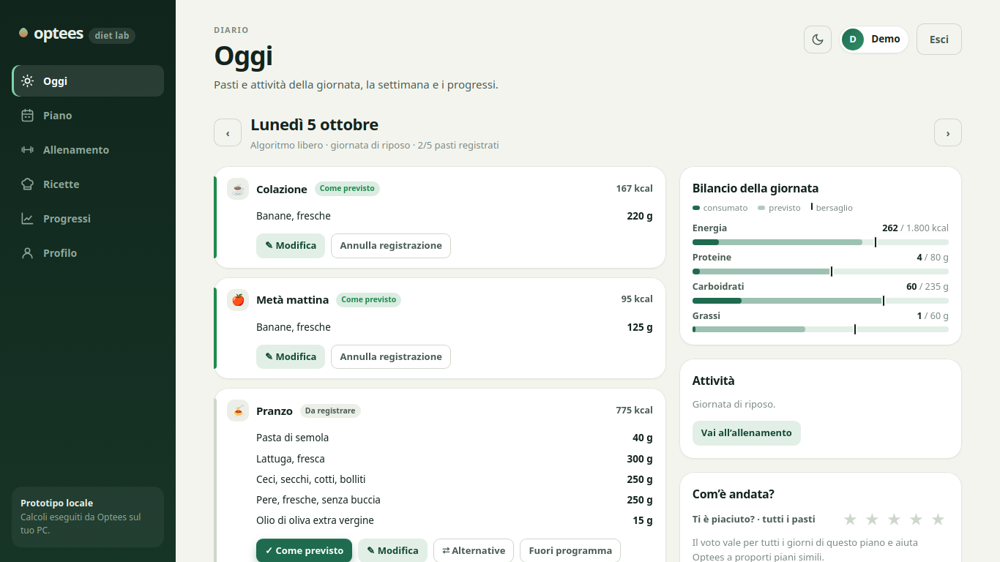
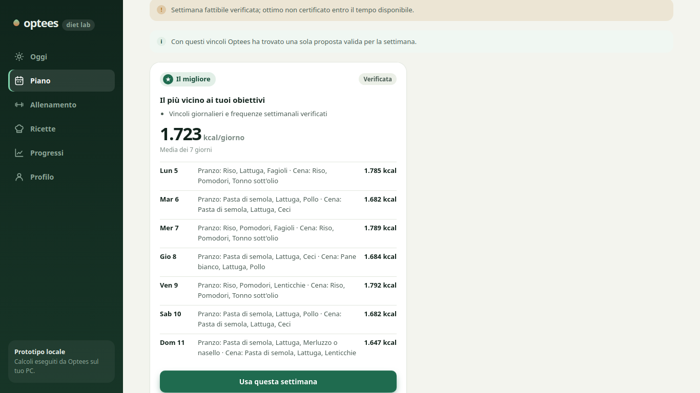
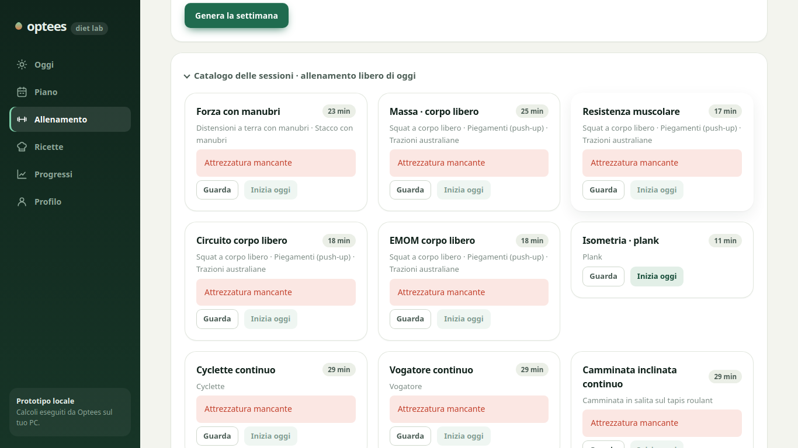
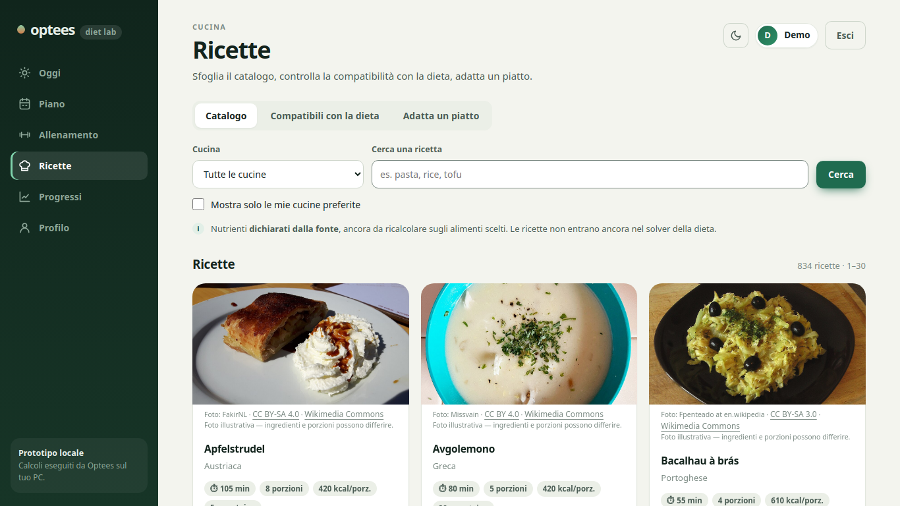
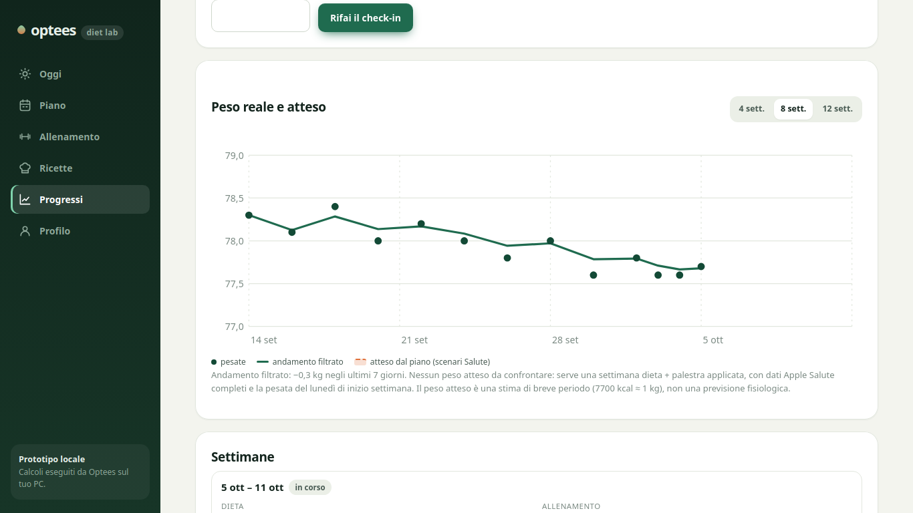
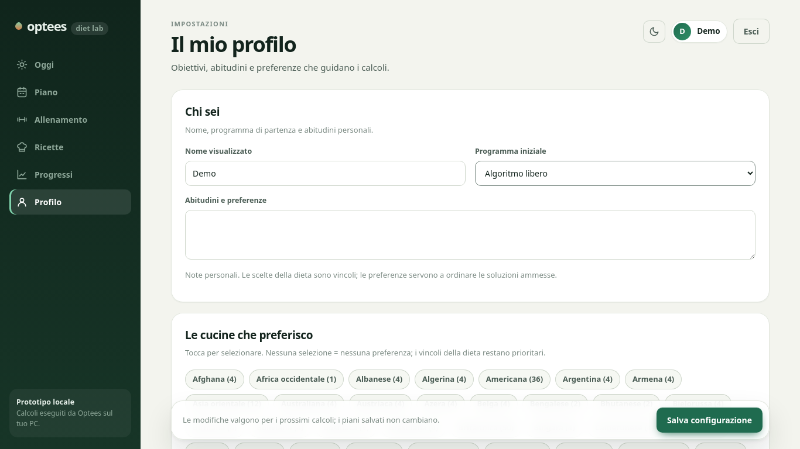

# Optees Diet Case of Study · Diet Lab

**English** · [Italiano](README.it.md)

A personal app for planning and logging nutrition and training, built on the **Optees** mathematical optimisation engine (a MILP solver called through the MCP protocol).

> **Languages.** The interface is being prepared for Italian and English (see [Localisation](#localisation)). The screenshots below still show the Italian interface.

## Where personal data lives (outside Git)
Sensitive data is excluded from version control by [`.gitignore`](.gitignore):
- `data/personal/`: the local SQLite database `web.sqlite`, personal notes and generated credentials, written with `0600` permissions by [`web/app.py:initialize`](web/app.py); personal equipment settings from [`scripts/workout_configuration.py:seed_legacy_equipment`](scripts/workout_configuration.py). Demo profiles use neutral defaults from [`web/app.py:defaults`](web/app.py).
- `sanitary_data_export/`: the raw Apple Health export (`export.zip`).
- `private_docs/`: private documents.
- `.env` and `*.sqlite*`: machine-specific environment variables and database copies.

## Running the app
1. Create `.env` from `.env.example` and set the Python interpreter (`DIET_PYTHON`).
2. Start the local web server on `http://127.0.0.1:8765`:
```bash
./scripts/start_web.sh
```
To run on an isolated temporary database: `DIET_WEB_DB=/tmp/demo/web.sqlite ./scripts/start_web.sh`.

The solver and the test suite also need the CREA food tables, which are not distributed (see [Third-party data and licences](#third-party-data-and-licences)).

## Screens

### Today
Daily dashboard served by [`web/app.py:read_day`](web/app.py) through [`scripts/diary_service.py:day_view`](scripts/diary_service.py). It handles the five meals of the day (breakfast, mid-morning snack, lunch, afternoon snack, dinner; there is no evening snack) and the day's training. Each meal is confirmed with one tap or edited (grams, foods added, removed or swapped). Planned meals from past days that were never touched count as *presumed* and are treated as eaten; a small banner lists the last 7 days of them for confirmation. "Off plan" logs a free meal as a calorie range, and "Week catch-up" adds up all logged deviations and proposes how to recover over the following days, changing as little as possible and never going below protected minimums ([`scripts/meal_rebalance.py:preview`](scripts/meal_rebalance.py), [`scripts/meal_rebalance.py:decide`](scripts/meal_rebalance.py)). "How did it go?" collects a 1–5 rating of the applied plan.


### Plan
Generates the joint diet + gym week with different targets for rest and training days ([`scripts/joint_orchestration.py:generate_week`](scripts/joint_orchestration.py)) and applies the chosen plan ([`scripts/joint_orchestration.py:apply_week`](scripts/joint_orchestration.py)). It shows the non-dominated alternatives (Pareto trade-offs) and the most robust plan, chosen by minimising the worst-case regret across energy-expenditure scenarios ([`scripts/joint_robustness.py:annotate_pool`](scripts/joint_robustness.py)).


### Training
Catalogue of the 11 standard sessions ([`scripts/workout_service.py:catalog`](scripts/workout_service.py)) from the protocols in `config/workout-protocols.json`, with posture images from Free Exercise DB, YouTube teaching videos and a set log with loads, reps, RPE and a rest timer.


### Recipes
International recipe book in `dataset/recipes/`, with nutrients computed from the official CREA tables and freely licensed images. It includes the Recipe Solver ([`scripts/plan_recipe.py:optimize_recipe`](scripts/plan_recipe.py)), which finds optimal gram amounts while respecting nutritional constraints and culinary proportions.


### Progress
Measurements and a weight trend cleaned of day-to-day noise with a scalar Kalman filter on daily medians (with an optional 7-day EMA series), as described in [`docs/backend-handoff-progress.md`](docs/backend-handoff-progress.md) and computed in [`scripts/progress_analysis.py:progress`](scripts/progress_analysis.py). It includes the Monday check-in ([`web/app.py:monday_check_in`](web/app.py)), which analyses the last two weeks of data and proposes protected recalibrations of the targets ([`scripts/progress_recalibration.py:make_proposal`](scripts/progress_recalibration.py)). If meals used by a check-in are corrected afterwards, the app asks whether to recalibrate again; recalibrations within the same week are chained and stay inside the same safety cap.


### Profile
Nutritional targets and the habits for the five daily meals ([`scripts/daily_meals.py:defaults`](scripts/daily_meals.py), [`scripts/daily_meals.py:validate`](scripts/daily_meals.py)).


## The optimisation chain in plain words
1. **Meals and recipes (MILP in 5 g steps)**: every portion is discrete and weighable ([`scripts/plan_diet_day.py:formulate`](scripts/plan_diet_day.py)); the Recipe Solver portions ingredients while preserving culinary proportions ([`scripts/plan_recipe.py:optimize_recipe`](scripts/plan_recipe.py)).
2. **Coordinated day**: main meals are balanced with breakfast and snacks, avoiding monotonous combinations of protein sources.
3. **Joint week (diet + training)**: [`scripts/joint_orchestration.py:generate_week`](scripts/joint_orchestration.py) combines the training schedule with energy needs that differ between training and rest days.
4. **Pareto front and robustness**: Optees generates optimal alternatives (best, most varied, preferred) and checks how stable they are against the real expenditure measured by Apple Health ([`scripts/joint_robustness.py:annotate_pool`](scripts/joint_robustness.py)).
5. **Continuous adaptation**: preferences learned with a UCB1 bandit, non-punitive recovery after off-plan meals, and controlled recalibration at the weekly check-in.

## Apple Health and Withings import
- Put the archive exported from the iPhone in `sanitary_data_export/`; there must be exactly one `.zip` file.
- The atomic import into the local SQLite database is handled by [`scripts/apple_health.py:import_zip`](scripts/apple_health.py).
- Biometric data (weight, body fat, resting and active energy) is used only with enough coverage: days covered for at least 20 hours out of 24 ([`scripts/apple_health.py:summarize`](scripts/apple_health.py)), at least 7 usable days out of 28, and data no older than 14 days ([`scripts/health_inputs.py:refresh_report`](scripts/health_inputs.py)).
- Step-by-step procedure (Italian): [`docs/apple-health-import.md`](docs/apple-health-import.md).

## Localisation
The interface is being set up for **Italian** (default) and **English**: interface texts live in translation files instead of being hard-coded, and the language can be chosen from the user menu. Food names from the CREA tables stay in Italian, because they are the names in the source data. The design and task documents in `docs/` are mostly in Italian.

## How the project is developed
Work is split into task cards in [`docs/tasks/`](docs/tasks/): red tests are written first by one agent, the implementation is done by another under [`GEMINI.md`](GEMINI.md), and [`scripts/check_task.py`](scripts/check_task.py) checks that only the allowed files changed and that the protected tests were not altered before review.

## Third-party data and licences

The project's code and documentation are released under the MIT licence ([`LICENSE`](LICENSE)). Third-party data keeps its own terms:

- **CREA food composition tables**: no open licence identified, so the derived tables (`dataset/crea/foods.csv`, `foods.json`) **are not included**. Rebuild them locally with `scripts/import_crea.py` from the public CREA pages (see `dataset/crea/README.md`), citing the source. Without these tables the solver and the test suite cannot run.
- **foodose**: CC BY 4.0, attribution in `dataset/recipes/README.md`.
- **UniTools recipes**: CC BY-SA 4.0 (`dataset/recipes/unitools/LICENSE`); derived data stays CC BY-SA 4.0.
- **Free Exercise DB**: Unlicense (`dataset/free_exercise_db/LICENSE.md`); exercise images in `web/static/media`.
- **RepDB**: use with attribution, redistribution as a dataset not allowed; the original files are not included.
- **Open Food Facts**: ODbL; downloaded data is not included, only the manifest and documentation.
- **USDA FoodData Central SR Legacy**: public domain; the archive is not included.
- **Recipe illustrations**: Wikimedia Commons, author and licence per image in `config/recipe-images.json`.

This is a personal case study: it is not a medical device and does not give clinical advice.
