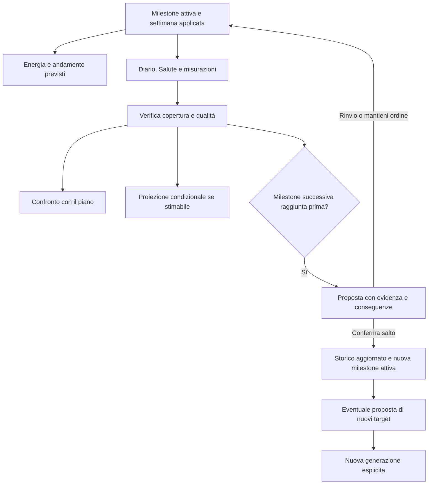

# Grafici energetici, proiezioni e milestone

7 ottobre 2026 · Specifica di prodotto per il redesign. Implementazione iniziale della fase 5 descritta in [rapporto fase 5](ux-phase5-implementation.md); i limiti del modello operativo sono distinti dalla specifica completa.

## Risultato desiderato

L'utente vede cosa prevede la settimana, cosa ha registrato e come sta cambiando la distanza dai propri traguardi. Può leggere una stima di quando li raggiungerà continuando con l'andamento attuale e confrontarla con l'aspettativa del piano. I traguardi sono milestone ordinate; il solver si basa sulla prima ancora da perseguire e non passa a una successiva saltando le precedenti senza scelta dell'utente.

## Base disponibile e nuove dipendenze

Nel codice corrente `progress_analysis.py` calcola peso filtrato, trend e atteso settimanale da scenari del piano congiunto. L'atteso è esplicitamente un bilancio energetico di breve periodo, non una previsione fisiologica: non basta prolungarne la retta per dichiarare una data attendibile lontana nel tempo. `personal_goals.py` memorizza un obiettivo corporeo con eventuale data e propone un bilancio con una data stimata. `health_inputs.py` distingue scenari utilizzabili da insufficienti/vecchi ed esclude il doppio conteggio dell'energia di allenamento.

Questi elementi sono riutilizzabili, ma una sequenza di milestone, il riconoscimento dei traguardi e le proiezioni dinamiche richiedono logica dedicata. L'analisi è sul codice; disponibilità effettiva delle serie e correttezza dei contratti vanno verificate nell'ambiente dimostrativo.

## 1 · Grafici energetici

Due viste allineate per giorni e unità, con confronto opzionale sovrapposto. Evitare quattro linee indistinguibili come vista iniziale.

| Vista | Serie | Origine e significato |
|---|---|---|
| Settimana prevista | Assunzione prevista | Pasti del piano selezionato/applicato, nell'ambito dichiarato; giornata intera distinta da solo pranzo/cena |
| Settimana prevista | Dispendio previsto | Scenari disponibili per quella settimana, con valore centrale e intervallo; fonte e data della stima |
| Giorni registrati | Assunzione registrata | Diario dichiarato dall'utente; stime dei pasti fuori programma conservano il proprio intervallo |
| Giorni registrati | Dispendio da Salute | Energia a riposo + attiva secondo le regole d'importazione; stima del dispositivo, con copertura del giorno |

Usare “registrato” e “stimato da Salute” nella UI: la parola “reale” da sola suggerirebbe una precisione che le fonti non garantiscono. Il confronto risponde alla richiesta di vedere previsto e reale, rendendone comprensibili i limiti.

Interazione: seleziona un giorno → valori delle quattro serie, differenza assunzione/dispendio, copertura e ingresso ai pasti o ai dati Salute. Giorni futuri mostrano solo il previsto; una giornata incompleta è marcata “parziale”, mai convertita in zero. Il saldo comparabile è assunzione meno dispendio, con segno spiegato; calcolarlo come risultato giornaliero solo quando i dati sono sufficienti. Non confrontare assunzione di due pasti con dispendio dell'intera giornata.

Salute già include le attività registrate nel proprio totale: non aggiungere nuovamente le calorie delle sessioni. Nel previsto usare la decomposizione già verificata dai servizi, senza sommare uno scenario giornaliero e lo stesso allenamento due volte.

Conservare snapshot/versione del previsto: una rigenerazione non riscrive retroattivamente il confronto storico. Se un rientro modifica il piano, mostrare la versione aggiornata con indicazione della modifica e mantenere consultabile la precedente. Stime fuori programma restano intervalli; dati mancanti sono interruzioni nella serie. Colore, tratteggio, legenda e tabella testuale distinguono tutte le serie.

Posizione: grafico compatto in Settimana per il piano attivo; confronto esteso e storico in Progressi; in Oggi solo riepilogo e accesso al dettaglio. Nel confronto fra bozze mostrare il previsto di ciascuna proposta, senza farlo apparire già applicato.

## 2 · Andamento degli obiettivi

Per ogni metrica supportata mostrare:

- Misure registrate e andamento filtrato, con date e provenienza.
- Valore della milestone attiva e distanza attuale; direzione o intervallo desiderato.
- Proiezione della settimana applicata, limitata all'ambito supportato dal modello.
- Proiezione condizionale “Se continui con questo andamento”, derivata da osservazioni sufficienti.
- Data desiderata, se scelta, distinta dalla finestra stimata di raggiungimento.

La proiezione dal piano e quella dall'andamento osservato sono due scenari diversi. La stima non deve assumere che i pasti futuri siano già stati consumati né confondere la scelta di un piano con un risultato corporeo.

Per peso, riusare e verificare il filtro corrente prima di definire finestre, soglie minime e trattamento dei cambi di direzione. Per grasso corporeo, circonferenze, forza o altre metriche non trasferire automaticamente il modello calorico: stimare solo dove esiste un metodo dedicato e dati adeguati. Gli obiettivi senza un modello restano visibili con progresso misurato e “Data non ancora stimabile”.

La finestra può avvicinarsi o allontanarsi al check-in o all'arrivo di nuove osservazioni sufficienti, non oscillare a ogni apertura della pagina. Mostrare l'aggiornamento e la base della stima. Esempio esclusivamente illustrativo: “Se l'andamento continua: tra fine novembre e metà dicembre. Stima aggiornata al check-in; circa una settimana prima della precedente”. Con dati insufficienti, andamento piatto/opposto o incertezza eccessiva, non inventare una data.

Conservare gli snapshot delle stime per spiegare i cambiamenti. Il tono comunica avanzamento e incertezza senza assegnare colpe o premi al saldo di una singola giornata. La data stimata non aggiorna automaticamente scadenze, obiettivi nutrizionali o intensità del piano.

## 3 · Milestone ordinate

Profilo → Obiettivi ospita creazione, modifica e ordine; Progressi mostra la sequenza e l'avanzamento; Settimana dichiara quale milestone guida la generazione.

Modello proposto: identificativo, ordine, titolo, criteri misurabili (metrica, valore/intervallo e direzione), eventuale data desiderata, stato e versione. Stati di lavoro: da perseguire, attiva, raggiungimento da confermare, completata, saltata, archiviata. Registrare evidenze, conferme e modifiche; separare raggiungimento di una metrica da completamento dell'intera milestone.

Una milestone può avere più criteri: per default tutti quelli dichiarati necessari devono essere soddisfatti. Il comportamento è da rendere esplicito nella UI. Per misure rumorose, definire per metrica un criterio di conferma basato su dati appropriati; un singolo punto non deve produrre un salto definitivo. Le soglie sono una dipendenza da specificare e testare, non valori già validati.

Regola richiesta: la prima milestone ancora da perseguire guida il solver. Un adapter traduce i suoi criteri compatibili nei parametri esistenti, rispettando vincoli permanenti e approvazioni dei target. Una milestone non supportata dal solver non va ignorata silenziosamente: mostrare quale criterio è solo monitorato e richiedere una configurazione risolvibile prima di generare.

Passaggio ordinario proposto: evidenza del raggiungimento → riepilogo → conferma del completamento → prossima milestone attiva. La nuova milestone non riscrive consumi, settimane applicate o target approvati; eventuali nuovi target sono una proposta esplicita. Questo passaggio di conferma è una scelta di design da verificare nel prototipo.

Raggiungimento anticipato richiesto dall'utente:

1. La milestone 2 risulta raggiunta mentre la 1 è ancora attiva.
2. Il sistema presenta evidenza e conseguenze: “Hai raggiunto questo traguardo. Vuoi saltare la milestone precedente e proseguire?”.
3. Azioni: “Salta e prosegui”, “Mantieni l'ordine”, “Decidi più tardi”. Mostrare esattamente quali milestone verranno saltate/completate e quale guiderà il prossimo piano.
4. Senza conferma la 1 resta attiva, anche dopo logout o nuova importazione.
5. Con conferma conservare la 1 come saltata, non come raggiunta; confermare la 2 sulla base dell'evidenza e attivare la prima successiva ancora da perseguire. Se non resta alcun traguardo, mostrare sequenza conclusa e proposta di nuovo obiettivo/mantenimento senza crearli automaticamente.

Per un traguardo ancora più avanti, elencare tutte le milestone intermedie coinvolte prima della scelta. Se sono soddisfatti solo alcuni criteri, mostrare progresso parziale e non proporre il salto come raggiungimento completo. Un rifiuto/rinvio non produce richieste ripetute a ogni accesso: persistere la decisione e riproporre solo per una nuova evidenza rilevante o su richiesta. Consentire revisione esplicita della sequenza senza cancellare lo storico.

Riordino e modifica mostrano l'effetto sull'obiettivo attivo e invalidano proposte obsolete; gli snapshot dei piani mantengono milestone e versione originali. Conservare un solo obiettivo attivo per utente e gestire modifiche concorrenti. Migrare l'obiettivo singolo esistente a una prima milestone preservando impostazioni e approvazioni.

## Schema del percorso

## Consegne e criteri di verifica

**5A — Energia:** grafici, dettaglio del giorno, tabella accessibile, copertura, intervalli e versioni. Provare giorni completi/parziali, Salute assente, piano parziale, sessioni già incluse e aggiornamento del piano.

**5B — Milestone:** persistenza e migrazione, editor della sequenza, evidenze, proposta di salto e adapter solver. Provare raggiungimento ordinario, successiva anticipata, multipli criteri, rifiuto/rinvio, modifiche concorrenti, fine sequenza e nessuna mutazione automatica dei piani.

**5C — Proiezioni:** metodo documentato per ogni metrica supportata, requisiti dei dati, finestre e snapshot delle stime. Provare andamento favorevole, piatto, opposto, dati insufficienti/vecchi e cambio milestone. Non mostrare date quando il metodo non le sostiene.

Nel prototipo usare dati sintetici dichiarati e includere un caso in cui la data si avvicina, uno in cui si allontana e uno in cui non è stimabile. Nessuna previsione o effetto motivazionale è ancora stato validato con l'app o con utenti.
