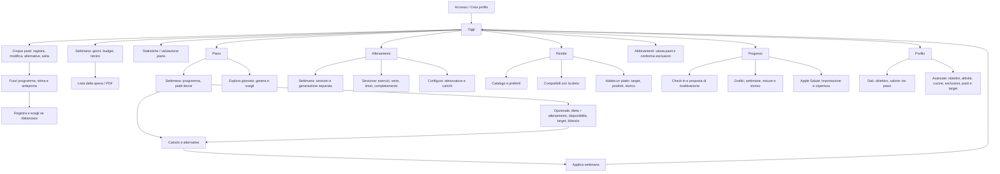
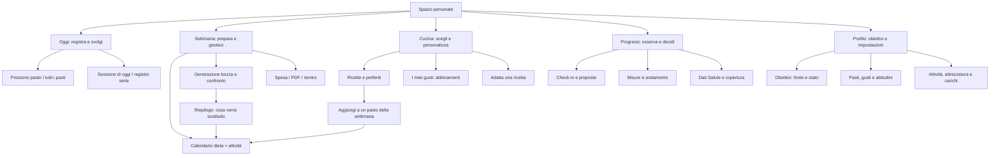

# Mappa UX e proposta di rimodellazione

Revisione del 7 ottobre 2026. Ambito: architettura dell'informazione, flussi, gerarchia UI e stati. Nessuna modifica all'applicazione.

Seguito della revisione: [roadmap del redesign](ux-redesign-roadmap.md). La proposta di primo uso è stata affinata con domande facoltative su gusti e abitudini al primo accesso, risposte modificabili nel Profilo e configurazione degli obiettivi separata. La roadmap dettaglia persistenza, rinvio, utenti esistenti e verifica dell'effetto delle preferenze sul piano.

## Base e limiti della revisione

Fonti: HTML, CSS e tutti i moduli frontend in `web/static/`; README; screenshot archiviati di Oggi, Piano e Profilo. Gli screenshot mostrano sei sezioni, il codice attuale sette: non sono una rappresentazione completa della versione corrente. I documenti `web-interface.md` e `design.md` contengono coperture precedenti, quindi non sono usati come inventario corrente.

Nella revisione iniziale il tentativo di aprire `http://127.0.0.1:8765` ha restituito connessione rifiutata: le evidenze originarie sotto derivavano dal codice e dagli screenshot. Successivamente la [fase 0](ux-phase0-findings.md) ha verificato nell'app demo interazioni, solver e casi mobile; quel rapporto aggiorna il livello di evidenza e le priorità. Contrasto e verifica completa da tastiera restano aperti. Nessuna ricerca utenti o misura di usabilità è stata effettuata. Il deficit riferito dal proprietario è l'input della revisione.

Ipotesi di lavoro: prodotto personale, con uso quotidiano sul telefono e pianificazione più occasionale anche su desktop. Priorità da ripesare se l'attività principale è diversa.

## Diagnosi

L'app ha un'identità visiva già riconoscibile e una base riutilizzabile: verde, superfici chiare, token, tema scuro, stati dei pasti, azioni nominate, focus CSS e movimento ridotto. Il problema più evidente è la distribuzione delle responsabilità: le funzioni sono cresciute per moduli, mentre l'utente deve ragionare per compiti. Le stesse pagine mescolano preparazione, esecuzione, analisi e configurazione.

Non serve iniziare sostituendo colori o stack. Serve rendere evidente, per ogni azione: cosa sto preparando, cosa verrà salvato, dove troverò il risultato e come correggerlo.

## Mappa attuale — ricostruita dal codice

Le frecce da Oggi alle sezioni rappresentano la navigazione globale disponibile; non un obbligo di passare da Oggi. La navigazione è gestita mostrando/nascondendo sezioni, senza route per schermata (`app.js:533–560`).

| Area | Compito principale | Compiti che oggi convivono | Fonte |
|---|---|---|---|
| Oggi | Registrare ciò che mangio e faccio | Settimana, spesa, budget, rientro, statistiche e voto del piano | `index.html#home`, `today.js`, `rebalance.js`, `shopping.js` |
| Piano | Preparare e applicare una settimana | Target personali, bilancio, disponibilità, pasti decisi, esplorazione del giorno e confronto | `index.html#planning`, `today.js:636,1017` |
| Allenamento | Eseguire e registrare una sessione | Secondo generatore settimanale, catalogo e configurazione | `index.html#workout`, `workout.js` |
| Ricette | Trovare e usare un piatto | Catalogo, preferiti, compatibilità, ottimizzazione autonoma e storico | `index.html#recipes`, `app.js:744,839`, `locked.js` |
| Abbinamenti | Esprimere gusti sui pasti | Filtri per pasto/riposo, voti, domande sulle esclusioni | `matches.js` |
| Progressi | Capire l'andamento e fare il check-in | Inserimento misure, importazione, copertura dati, ricalibrazione | `progress.js`, `app.js:1159` |
| Profilo | Stabilire obiettivi e abitudini | Setup guidato, molte configurazioni avanzate e forme di salvataggio differenti | `setup.js`, `goals.js`, `index.html#profile` |

## Percorsi principali e lacune

| Percorso | Attuale | Attrito | Proposta |
|---|---|---|---|
| Primo uso | Crea profilo → Oggi senza piano → Piano; setup raggiungibile da Profilo | L'ingresso propone generazione prima di chiarire la preparazione dei dati | Oggi senza piano: distingue “Completa il profilo” e “Prova con dati demo”; riepilogo dei requisiti, poi prima settimana |
| Settimana | Piano → opzioni → genera → alternative → applica → Oggi | Si imposta e si valuta nello stesso spazio; il risultato applicato è altrove | Settimana attiva → modifica disponibilità/piatti → genera bozza → confronto → riepilogo delle sostituzioni → applica → Settimana attiva con spesa |
| Correzione pasto | Modifica → può confermare previsto → quantità salvate al cambio campo → Fine | “Fine” chiude l'editor, non conferma il salvataggio | Bozza locale → riepilogo → Salva pasto; Annulla ripristina la situazione precedente |
| Allenarsi | Oggi/Allenamento → apri sessione → avvia → serie/timer → completa | La pagina Allenamento contiene anche pianificazione e setup | Sessione di oggi in primo piano; calendario e configurazione come ingressi secondari |
| Fuori programma | Stima → anteprima → registra con/senza rientro | La registrazione e la decisione sul futuro sono accoppiate | Mantieni la stima esplicita; distingui “Registra il pasto” da “Valuta modifiche future”, conservando l'anteprima prima dell'applicazione |
| Check-in | Progressi → importazione più in basso → peso → check-in → proposta | I prerequisiti sono descritti, ma fisicamente separati dall'azione | Nel check-in mostra data/copertura dell'importazione e ingresso diretto all'aggiornamento; proposta con prima/dopo e approvazione esplicita |

## Problemi prioritari

Priorità basate sull'impatto sul compito, senza dati di frequenza. Confidenza alta = evidenza esplicita nel sorgente; media = conseguenza UX da confermare. Effort indicativo, non stima di sviluppo.

| ID / priorità | Evidenza localizzabile | Conseguenza | Correzione concreta | Confidenza / effort | Verifica |
|---|---|---|---|---|---|
| U1 · Alta | `today.js:245–317`: Modifica su pasto previsto non registrato chiama `diary/confirm`; `itemRow:129` salva con `onchange`; Fine chiude soltanto | Aprire una modifica cambia già il diario; non esiste una bozza con annullamento nell'editor | Editor con bozza, Salva e Annulla; oppure autosalvataggio dichiarato e annullamento delle modifiche | Alta / Medio-alto | Apri, cambia quantità, esci senza salvare: diario invariato; errore di salvataggio conserva la bozza |
| U2 · Alta | `today.js:1017`: `jointRequest` salva target e bilancio nel profilo prima della richiesta di generazione | “Genera” può cambiare impostazioni personali anche se il calcolo fallisce | Separa parametri della bozza e impostazioni; mostra ambito e richiedi un'azione esplicita per rendere permanenti i nuovi target | Alta / Medio-alto | Fallimento della generazione non modifica il profilo; modifica permanente chiaramente confermata |
| U3 · Alta | `load()` entra nel workspace e carica Oggi; setup è in Profilo; lo stato vuoto invita a pianificare | Primo percorso non rende evidente la differenza fra prova demo e piano configurato | Stato di preparazione visibile in Oggi e Piano; ingresso al setup senza obbligare utenti ricorrenti a rifarlo | Alta sul collegamento, media sull'impatto / Medio | Nuovo profilo sa quali dati usa la prima generazione e come completarli |
| U4 · Media | `index.html#planning` e `#workout`: due “Genera la settimana”, con disponibilità in entrambi | Difficile capire quale calendario venga usato e dove gestirlo | Un luogo per la settimana; da Allenamento collegamento contestuale alla pianificazione delle sessioni | Alta / Alto | Genera, cambia sessione e torna: settimana e provenienza del piano sono leggibili; verifica le regole di sostituzione backend |
| U5 · Media | `setup.js`, `goals.js`, Profilo e opzioni congiunte espongono obiettivi/bilancio/target; impostazioni personali come banana o seconda barretta sono nel form condiviso | Impostazioni distribuite e abitudini molto specifiche presentate come modello generale | Un riepilogo Obiettivi con fonte/data/ambito; Pasti e abitudini separati, varianti personali mostrate nel contesto pertinente | Alta / Medio-alto | Un obiettivo si modifica da un percorso evidente; gli altri ingressi mostrano lo stesso valore e fonte |
| U6 · Media | `index.html#home`, screenshot `02_oggi.png`: cinque pasti aperti + attività + bilancio + settimana + statistiche; `shoppingBlock` è nel budget settimanale | Compiti giornalieri e settimanali competono; spesa poco riconoscibile come destinazione | Oggi concentra registrazione e sessione; Settimana ospita calendario, spesa e rientro; grafici estesi in Progressi | Alta sulla struttura, media sull'attrito / Medio | Trova il prossimo pasto e la spesa senza esplorare pannelli non pertinenti |
| U7 · Media | CSS mobile `style.css:1401`: sette voci condividono il 100% della barra; etichette da 11px | Rischio di compressione con “Allenamento” e “Abbinamenti”; ingombro da verificare | Quattro ingressi di lavoro e Profilo nell'header; unifica Ricette e gusti sotto Cucina | Alta sulla regola, media sull'overflow / Medio | 360/390px, testo ingrandito, nomi lunghi: nessuna sovrapposizione, azioni raggiungibili |
| U8 · Media | `app.js:533–560`: navigazione senza URL/history, scroll azzerato, nessuna gestione focus nel cambio pagina | Indietro del browser non segue le sezioni; contesto e posizione non rappresentati nell'URL | Route leggere o hash con tab/data; ripristina scroll e focus logico per ritorni al contesto | Alta / Medio | Indietro/avanti e ricarica ripristinano sezione/data; lettore e tastiera ricevono un cambio comprensibile |
| U9 · Media | `message()` nasconde messaggi dopo 7s; `mutate()` intercetta errori e `loadHome()` lega giorno, settimana e statistiche in `Promise.all` | Errore importante effimero; errore nelle statistiche impedisce il rendering iniziale anche del giorno | Errori persistenti vicino all'azione con Riprova; caricamenti indipendenti e stato parziale per contenuti secondari | Alta / Medio | Fallisce solo stats: diario visibile; fallisce salvataggio: input e messaggio ancora disponibili |
| U10 · Media | `weekPlanCard` mostra sette giorni in ogni proposta; badge “Ottimo certificato”; programma “Algoritmo libero” | Confronto lungo e linguaggio del motore prima dei criteri di scelta | Riepilogo comparabile: pasti che cambiano, allenamenti, scostamenti rilevanti; dettagli e certificazione consultabili; “Piano personalizzato” con descrizione precisa | Alta sulla UI, media sulla comprensione / Medio | Due proposte distinguibili senza leggere tutti gli ingredienti; i limiti restano accessibili |
| U11 · Media | `renderWeek:534`: stati dei pasti espressi con punti colorati e `title`, mentre nome accessibile del giorno contiene solo la data | Sul touch e per lettura assistita, i singoli stati non sono altrettanto espliciti | Riepilogo testuale “3/5 registrati”, dettagli su selezione; includi stato nel nome accessibile | Alta / Basso | Stato comprensibile senza hover e senza colore |

## Cosa preservare

- Identità verde e palette già tokenizzata; tema chiaro/scuro, scale di superfici e ombre.
- Conferma rapida “Come previsto”, confronto previsto/consumato e distinzione delle stime.
- Protezione dei pasti registrati, anteprima del rientro e approvazione delle ricalibrazioni.
- Piatti già decisi, preferiti e lista della spesa: funzioni utili da collegare meglio al calendario.
- Pulsanti alternativi ai gesti in Abbinamenti e stati pendenti delle ricalibrazioni ripristinati dal server.
- Dettagli tecnici disponibili su richiesta: non perdere verificabilità del caso di studio.

## Architettura proposta

Quattro ingressi principali, Profilo nell'header. La proposta non elimina capacità: cambia le responsabilità e le connessioni. Desktop: sidebar; mobile: quattro voci con etichette complete.

Tradeoff: Allenamento perde la voce autonoma. Per compensare, la sessione è raggiungibile direttamente da Oggi e il calendario da Settimana; la sessione deve avere una pagina dedicata con ritorno al contesto. Se l'allenamento è l'uso dominante, mantenere una quinta voce Allenamento e trattare Cucina come destinazione secondaria. La scelta va validata sul compito reale prima di implementarla.

Non trasformare tutta la pianificazione in un wizard obbligatorio. L'utente ricorrente parte dal piano attivo e modifica solo i vincoli necessari; separare preparazione, confronto e applicazione chiarisce la decisione senza far reinserire i dati.

## Schema visivo e stati

Aprire `ux-redesign-wireframes.html`: wireframe statici di Oggi mobile, Settimana desktop e modifica pasto. Contenuti illustrativi, nessun collegamento ai dati reali. Non è un prototipo funzionante.

Direzione visiva: mantenere le superfici esistenti, differenziare piano di sfondo, contenuto e editor attraverso bordi e ombre discrete; tipografia più netta fra stato, compito e dettaglio. Variante con maggiore profondità: elevazione sul solo editor e sull'azione corrente, evitando di far competere tutte le card. Oggetti 3D non sembrano utili nei flussi di registrazione e confronto.

| Stato | Comportamento proposto |
|---|---|
| Nessun piano | Registra comunque; mostra perché manca il piano e il prossimo passo per crearne uno |
| Dati demo/parziali | Badge persistente nel riepilogo obiettivi e prima della generazione, con ingresso alla configurazione |
| Generazione in corso | Stato del calcolo, dati di partenza leggibili; non mostrare percentuali inventate |
| Nessuna soluzione | Spiega i vincoli problematici se il backend li fornisce; conserva configurazione e guida alla correzione |
| Conflitto durante applicazione | Mantieni il confronto; spiega i dati cambiati e offri rigenerazione |
| Errore di modifica | Bozza conservata, messaggio persistente e nuovo tentativo |
| Pasti registrati protetti | Anteprima chiara di ciò che cambia e di ciò che resta registrato |
| Salute non disponibile | Specifica fonte assente/vecchia/copertura insufficiente; non rappresentarla come zero |
| Permesso/importazione assente | Motivo e percorso alternativo pertinente, senza controlli apparentemente guasti |

## Ordine del redesign

1. Mettere in sicurezza il significato delle azioni: bozza/salvataggio pasto e ambito delle modifiche ai target (U1–U2).
2. Definire il percorso primo uso e il punto unico per obiettivi e calendario (U3–U5).
3. Disegnare Oggi e Settimana, compreso confronto/applicazione/spesa; ridurre la navigazione mobile (U6–U7, U10).
4. Collegare Cucina e gusti ai pasti, organizzare Progressi e importazione; completare navigazione e stati robusti (U8–U9, U11).
5. Rifinire densità, microtesti e profondità sul design system corrente, dopo aver verificato i flussi.

Prima dell'implementazione: eseguire in un profilo dimostrativo i percorsi della tabella, desktop e 360/390px, tastiera e zoom 200%; includere errori, uscita dall'editor, due piani a confronto e conflitto di applicazione. Non dichiarare accessibilità o prestazioni migliorate senza queste prove.

Segnali utili, anche raccolti manualmente: riesce a registrare/correggere il pasto senza cambiare dati involontariamente? Trova il piano applicato e la spesa? Spiega la differenza fra due proposte? Sa quali obiettivi usa la generazione? Nessuna nuova telemetria è necessaria per questa prima verifica.
# Aggiornamento fase 0

Le prime verifiche nell'app e nei servizi sono documentate nel [rapporto fase 0](ux-phase0-findings.md): confermano la registrazione implicita all'apertura di Modifica e la collocazione dei gusti nelle impostazioni avanzate. Il rapporto aggiunge ambito energetico ambiguo e un caso di settimana iniziata fuori dal lunedì; distingue le prove concluse dalle verifiche ancora aperte. La revisione originale sotto conserva le proprie indicazioni di evidenza.

## Aggiornamento fase 1 · 8 ottobre 2026

La [mappa proposta dei flussi e ricollocazione delle funzioni](ux-phase1-design.md) integra questa revisione. I [wireframe](ux-redesign-wireframes.html) sono ora un prototipo navigabile indipendente: le proposte non rappresentano modifiche già implementate nell’app.

## Aggiornamento dopo la fase 4

8 ottobre 2026: U1 e U2 sono risolti rispettivamente nelle fasi 3 e 4. I rilievi precedenti documentano la base del redesign, non il comportamento della versione corrente. Si vedano [Oggi e registrazione](ux-phase3-implementation.md) e [Settimana, confronto e applicazione](ux-phase4-implementation.md) per implementazione, prove e limiti.

## Aggiornamento fase 5 · 8 ottobre 2026

Cucina collega ricette pronte e pasti futuri; Progressi apre con energia prevista/registrata, copertura e versioni. Traguardi ordinati nel Profilo, conferme e finestre condizionali sul peso: [rapporto e limiti](ux-phase5-implementation.md). La mappa precedente resta la base storica della revisione iniziale.
