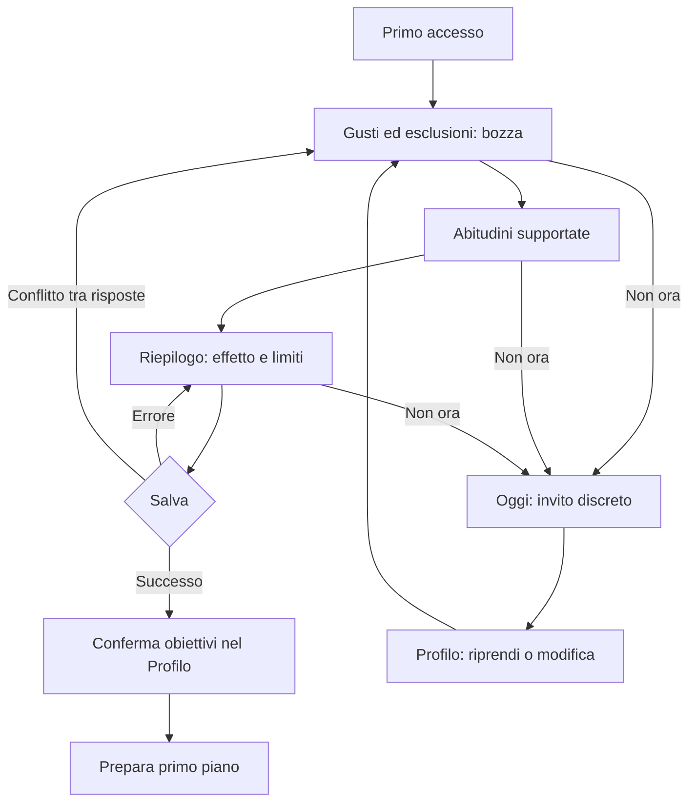
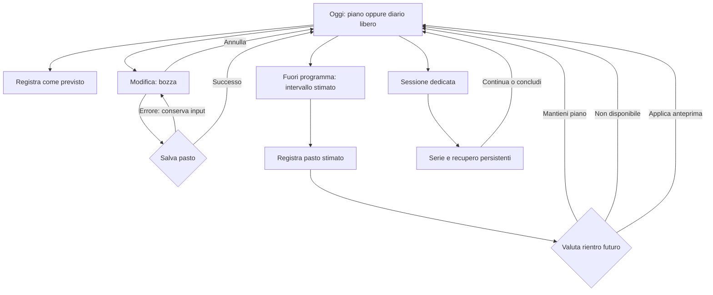
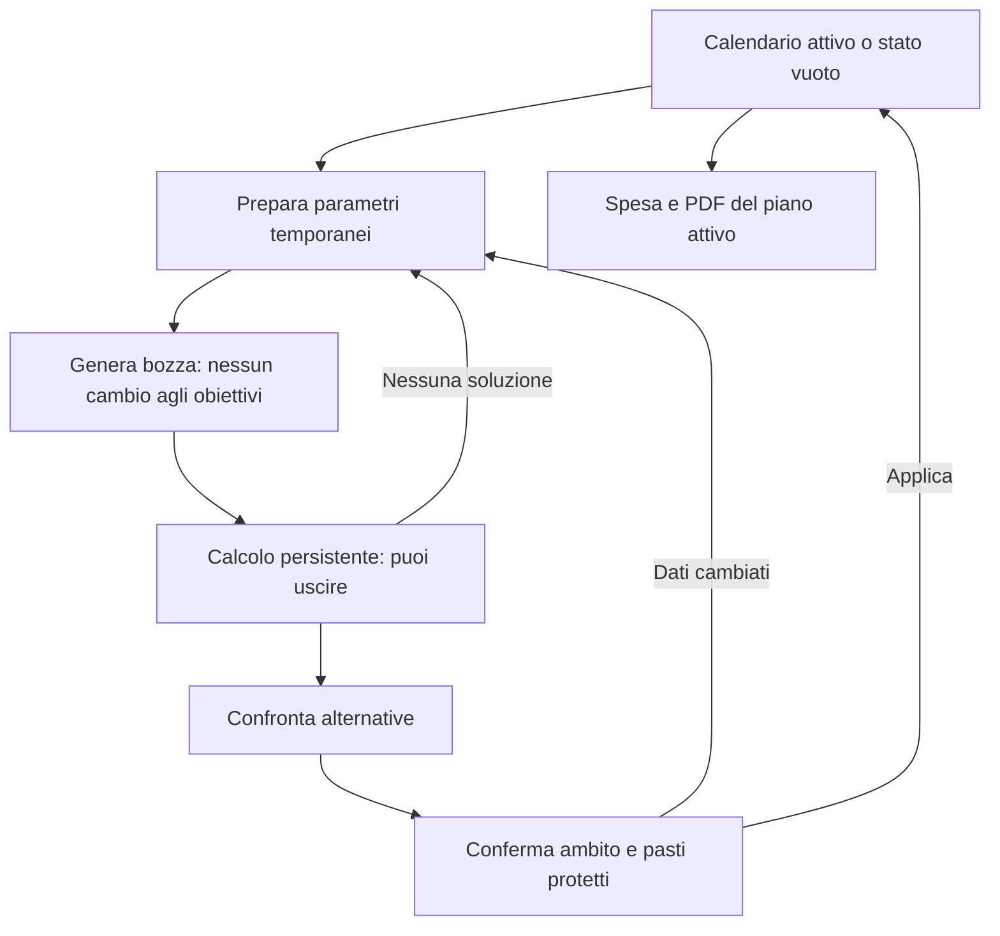

# Fase 1 · Flussi e prototipo del redesign

8 ottobre 2026 · Proposta di design basata sulle evidenze della [fase 0](ux-phase0-findings.md). Nessuna modifica al frontend operativo o al database dell’app.

## Risultato reviewabile

[Apri il prototipo](ux-redesign-wireframes.html). Sostituisce i wireframe statici precedenti; HTML, CSS e JavaScript senza dipendenze. Per aprirlo dal browser: `http://127.0.0.1:8878/ux-redesign-wireframes.html`. Può essere aperto anche come file locale, con persistenza dipendente dal browser.

“Ricomincia la demo” apre il primo accesso. La demo conserva soltanto dati sintetici nel localStorage del browser; non chiama API, Apple Salute o solver. Le simulazioni di errore sono azioni esplicite. Preferenze, calcolo, sessione e scelta milestone sopravvivono alla ricarica nella demo: nel prodotto dovranno essere persistenti per account. Il prototipo dimostra sequenze e gerarchia, non contratti backend funzionanti.

## Architettura e priorità

Quattro sezioni principali: **Oggi**, per registrare; **Settimana**, per pianificare; **Cucina**, per trovare e affinare; **Progressi**, per osservare e decidere. Profilo nell’header. Su telefono la navigazione resta in basso; su desktop è sotto l’header. Palette verde, token cromatici, superfici e tema scuro riprendono l’app. La profondità si limita a bordi e ombre discrete: grafici e azioni hanno priorità sulla decorazione.

Allenamento conserva una destinazione dedicata, accessibile direttamente da Oggi e Settimana e tramite Profilo. Non aggiungiamo una quinta voce in questa proposta: la sessione è un compito del giorno e la pianificazione appartiene alla settimana. Se la revisione del proprietario mostra che il catalogo è l’ingresso quotidiano dominante, rivalutare la voce autonoma prima della fase 3.

I percorsi correnti osservati e le lacune sono nel rapporto fase 0. Le mappe seguenti sono **proposte**, non rappresentazioni dell’app già implementata.

## Primo accesso e ritorno al Profilo

Attuale: login → Oggi → Profilo con molte impostazioni e poco orientamento. Proposta: login → breve invito facoltativo → piatti ed esclusioni → abitudini supportate → riepilogo degli effetti → obiettivi separati → primo piano.

| Passaggio | Decisione e conseguenza | Recupero |
|---|---|---|
| Piatti ed esclusioni | Gradimento e vincolo esplicito sono distinti; nessuna promessa generale sugli allergeni | Risposte neutre non diventano negative |
| Abitudini | Solo domande collegate ai contratti verificati; banana è un esempio supportato, non il questionario completo finale | Tempo di cucina rinviato; cucine restano filtri catalogo |
| Riepilogo | Salvataggio esplicito; vale per nuove proposte | Errore conserva bozza; esclusione banana e spuntino banana richiedono correzione |
| Non ora | Stato rimandato, senza riapertura forzata | Invito discreto e Profilo; utente esistente mantiene dati e piano |
| Profilo | Gusti, Obiettivi, Attività, Dati e account separati | Riepilogo prima delle impostazioni avanzate |

Il prodotto deve distinguere risposte in bozza da preferenze applicabili, con stato/versione per account. Nella demo le risposte sono una bozza locale; il riepilogo ne salva una copia utilizzata nel Profilo. Non dimostra migrazione, isolamento multiutente o logout reale.

## Oggi: diario, fuori programma, sessione

Attuale: Modifica può registrare il previsto; quantità vengono salvate durante l’editing. Proposta: apertura → bozza → Salva o Annulla → risultato persistente. Registrazione fuori programma separata dal rientro futuro.

Nel prodotto l’editor include ricerca, aggiunta, sostituzione, rimozione, quantità e un unico salvataggio coerente. La demo rende interattive quantità, rimozione, annullamento ed errore; il selettore alimenti è descritto come destinazione, senza simulare un catalogo completo. La bozza non ancora salvata deve poter essere recuperata dopo navigazione/ricarica; l’uscita esplicita consente conservarla o scartarla. Restano azioni rapide: saltare pasto, annullare registrazione, alternativa, pasto libero e barcode.

La giornata incompleta non appare come deficit definitivo. Assunzione della giornata intera distinta da un piano limitato a pranzo/cena. Nessun errore secondario di Salute o statistiche deve bloccare il diario. Lo stato di salvataggio fallito resta vicino al form, con nuovo tentativo.

Sessione: destinazione autonoma; ritorno al giorno o calendario d’origine. Recupero basato su scadenza temporale, non su un contatore perso alla ricarica. Conclusione parziale mostra le serie svolte.

## Settimana: preparazione, confronto, applicazione

Attuale: generatori distribuiti, alcuni parametri salvati nel Profilo prima del risultato, contesto del calcolo perso dopo reload. Proposta: calendario attivo → parametri della bozza → calcolo ritrovabile → confronto → conferma ambito → piano applicato.

- Ambito esplicito: dieta, attività o congiunto. La selezione accompagna generazione e conferma.
- Obiettivi permanenti restano separati. Anche un calcolo fallito non li modifica.
- Protezione dei pasti registrati obbligatoria; piatti fissati visibili, senza toggle che suggerisca di poter sovrascrivere il diario.
- Confronto: differenze di pasti, impegno attività, valori disponibili e copertura delle previsioni. Dettagli tecnici progressivi.
- Applicazione: prima/dopo, ambito e elementi protetti; conflitto conserva parametri e propone rigenerazione.
- Una sola proposta rimane applicabile; nessuna proposta mostra il motivo e il ritorno ai vincoli. Nel prodotto lo stesso contenitore gestisce calcolo interrotto, in coda, errore e recupero.

La demo simula due proposte e un’attesa di quattro secondi, oltre a nessuna soluzione e conflitto. Non effettua controllo concorrente, generazione o aggiornamento atomico reale.

## Progressi: energia, obiettivi e milestone

Energia: previsione applicata e versione, assunzione dal diario e dispendio stimato da Salute su base omogenea. Linea tratteggiata per previsto, continua per registrato, legenda testuale e tabella dei valori. Futuro e assenze non diventano zero; diario incompleto non diventa deficit; totale Salute è attiva + riposo senza sommare ancora attività già incluse.

Andamento: misure osservate, scenario settimanale e fascia condizionale distinta dalla data desiderata. Tre stati reviewabili: stima che si avvicina, che si allontana, non disponibile. Il modello fisiologico deve ancora essere definito/validato: numeri e finestre sono esempi UI, non previsioni cliniche né risultati dell’attuale solver. Nel prodotto l’assenza di un modello supportato impedisce di mostrare un’ETA, anche se esiste un saldo energetico.

Milestone: ordine, criterio e stato visibili; il solver usa la prima ancora da perseguire. Raggiungimento successivo anticipato → proposta persistente → mantieni, rimanda o valuta salto → conferma delle conseguenze. Saltata e raggiunta restano stati diversi; piano applicato non cambia automaticamente. Rifiuto/rinvio sopravvivono e non riaprono un popup a ogni accesso. La demo usa una seconda milestone di attività raggiunta mentre la prima di peso è ancora attiva, evitando un esempio matematicamente impossibile di due soglie di peso già superate.

## Ricollocazione delle funzioni attuali

Inventario ricostruito dai moduli in `web/static`, dall’audit e dalla fase 0. “Destinazione” indica il progetto da implementare, non un collegamento backend già pronto.

| Funzione attuale | Destinazione proposta | Accesso e ritorno |
|---|---|---|
| Diario, pasti, nutrienti, quantità e fonti alimenti | Oggi → pasto e dettagli energia | Giorno conservato |
| Conferma, correzione, salto, annullamento e alternative | Oggi → pasto | Diario aggiornato dopo salvataggio |
| Fuori programma e rientro | Oggi → registrazione → rientro | Registrazione distinta dal piano futuro |
| Generatore dieta, modalità, target nutrienti | Settimana → prepara → solo dieta | Obiettivi permanenti in Profilo |
| Generatore allenamento e disponibilità | Settimana → prepara → solo attività | Dettagli Attività |
| Generatore congiunto e scenari energia | Settimana → prepara → dieta e attività | Calcolo/proposte ritrovabili |
| Alternative, valutazioni, spiegazioni, ulteriori risultati | Settimana → confronto → dettagli | Ritorno al set di proposte |
| Piatti fissati, preset e cena fuori | Settimana → vincoli | Protezione in conferma applicazione |
| Calendario dieta e sessioni pianificate | Settimana → giorno | Oggi o sessione con ritorno |
| Lista spesa, spunta, esportazioni e PDF | Settimana → Spesa / Report | Versione del piano applicato |
| Catalogo ricette, ricerca, cucine, preferiti | Cucina → catalogo | Filtri conservati |
| Importazione, ricette personali e cronologia | Cucina → ricette personali | Torna al catalogo |
| Adattamento ricetta, prodotti e opzioni compatibili dieta | Cucina → dettaglio → adatta | Pasto/bozza di provenienza |
| Abbinamenti, giudizi, esclusioni proposte | Cucina → affina gusti; Profilo → gusti | Nessuna esclusione implicita |
| Barcode, etichette, prodotti personali | Oggi → aggiungi; Cucina → prodotti | Quantità confermata nella bozza |
| Catalogo attività e allenamento libero | Oggi → Attività | Sessione con ritorno al giorno |
| Serie, carichi, RPE, intensità, recupero e conclusione | Sessione dedicata | Progresso persistente |
| Attrezzatura, capacità iniziali, limiti e priorità | Profilo → Attività e attrezzatura | Collegato dai parametri settimana |
| Peso, altre misure, grafici e riepiloghi settimanali | Progressi → andamento / check-in | Periodo e metrica conservati |
| Check-in, ricalibrazioni, proposte e cronologia decisioni | Progressi → check-in | Anteprima e conferma esplicita |
| Importazione Salute, copertura, fonti e record | Profilo → Dati; link da Progressi | Ritorno al check-in |
| Target, bilancio energia, timing pasti, obiettivi personali | Profilo → Obiettivi | Parametri temporanei separati |
| Pasti abituali, banana, frutta, barrette e prodotti | Profilo → Gusti e abitudini → avanzate | Supporto del motore dichiarato |
| Note personali e preferenze cucina | Profilo → Gusti → avanzate | Note promemoria; cucine filtro |
| Login, logout, account e tema | Profilo → Dati e account; tema impostazione | Nessun dato perso al cambio sezione |
| Setup iniziale e conferma dati personali | Primo accesso + Profilo → Obiettivi | Gusti facoltativi separati |

## Navigazione e componenti

Hash proposti: `#oggi?data=YYYY-MM-DD`, `#pasto?data=...`, `#settimana?tab=calendario`, `#settimana?tab=prepara`, `#cucina`, `#progressi?stato=parziale`, `#profilo?tab=gusti`, `#sessione?ritorno=settimana`. Il parametro `stato` è soltanto un controllo demo. Nel prodotto periodo, metrica, giorno e proposta usano identità reali.

Indietro ripercorre la cronologia senza salvare implicitamente; il prodotto ripristina focus del controllo di ingresso, filtri e posizione. Cambio sezione sposta il focus al contenuto principale. La demo usa hash reali e focus su main al cambio URL; i passaggi interni del questionario e del calcolo richiederanno focus sul titolo/stato aggiornato durante l’implementazione. Niente dialog annidati: decisioni complesse hanno una pagina con azioni e ritorno espliciti.

Componenti condivisi previsti: riepilogo con fonte, stato piano/bozza, form con errore persistente, azioni Salva/Annulla, confronto alternative, copertura dati, serie grafico + tabella, milestone + proposta decisionale, scheda sessione con recupero. Focus visibile e movimento ridotto già definiti; accessibilità completa da verificare sul frontend implementato.

## Limiti e passaggio all’implementazione

Le destinazioni secondarie (editor completo ricette, barcode, PDF, riordino milestone e impostazioni avanzate) sono rappresentate da wireframe descrittivi o feedback esplicitamente simulato. I tre flussi principali e le decisioni delle milestone sono navigabili; non tutte le funzioni del prodotto sono simulate. La demo ha un solo pasto e una sessione campione, non un diario per data, un account o un motore di stima.

La fase 2 deve implementare schema/versione e persistenza del questionario, migrazione delle preferenze correnti e contratti reali dei dati supportati. Definire anche schema milestone e adapter dell’obiettivo attivo prima di collegare Settimana. Le altre sezioni entrano nelle rispettive fasi 3–5; l’aspetto del prototipo resta una base reviewabile, non una certificazione della UI finale.

Segnali da verificare senza aggiungere analytics: l’utente distingue bozza e registrazione, ritrova il calcolo dopo reload, sa dove modificare i gusti, interpreta i dati incompleti e comprende quale milestone guida il piano.

## Verifiche eseguite sul prototipo

- Primo accesso: selezione, passi, riepilogo, errore simulato, nuovo tentativo, salvataggio e generazione. Rinvio conservato dopo reload e ripresa dall’invito.
- Settimana: attesa ritrovata dopo reload, due proposte disponibili, scelta e conferma applicazione.
- Diario: errore mantiene 60 g, salvataggio esplicito; bozza 90 g ritrovata dopo reload e annullata lasciando la registrazione precedente invariata.
- Fuori programma: registrazione porta alla decisione separata sul rientro.
- Sessione: una serie e scadenza del recupero conservate dopo reload.
- Milestone: scelta, seconda conferma, stati saltata/raggiunta/attiva conservati dopo reload. Stato ETA assente senza proiezione.
- Layout: Oggi, Settimana e Progressi a 360 px, Oggi e primo accesso a 390 px; nessun overflow orizzontale globale nelle misure effettuate. Osservate superfici e controlli in tema chiaro e scuro. Focus su main al cambio hash; interazione del campo quantità e uscita con Tab.
- Controllo sintassi JavaScript e diff whitespace superati. Nessuna suite del backend rieseguita, perché il codice dell’app non è stato modificato.

Anteprime: [Progressi desktop](screenshots/ux-phase1/progressi-desktop.png), [Progressi 360](screenshots/ux-phase1/progressi-360.png), [Oggi 390](screenshots/ux-phase1/oggi-390.png), [Primo accesso 390](screenshots/ux-phase1/primo-accesso-390.png).

Non verificati integralmente: screen reader, contrasto misurato, zoom 200%, tutte le destinazioni secondarie, gestione concorrente reale, account multipli e validità delle stime. Queste prove appartengono all’implementazione e alla fase 6; non sono sostituite dalle schermate della demo.
